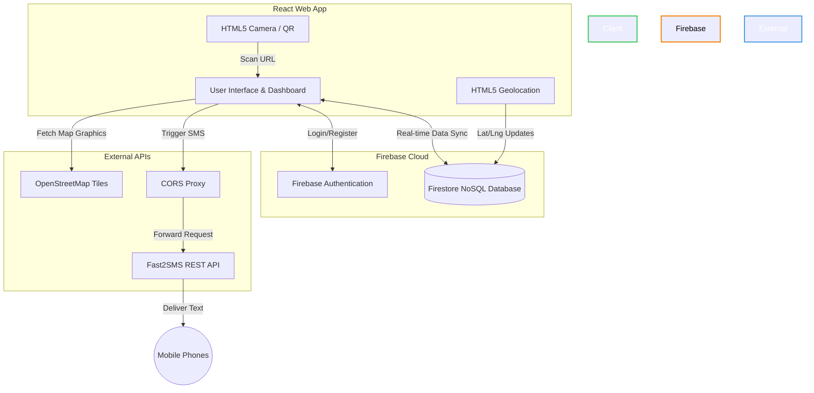
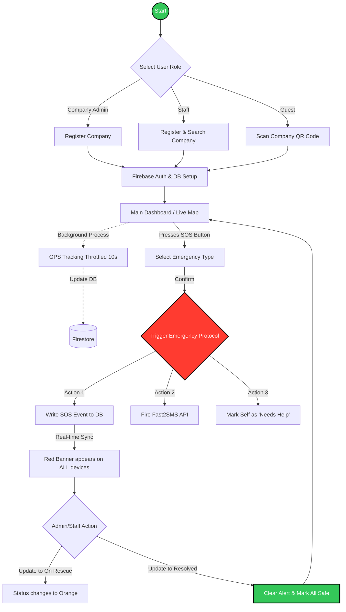

# SafeSignal: Emergency SOS & Safety Platform

This document contains the complete technical details, diagrams, and explanations designed specifically for your hackathon PowerPoint presentation. 

## 1. Complete Tech Stack

**Frontend Framework & Build Tool**
*   **React.js (v18)**: Core library for building the dynamic, component-based user interface.
*   **Vite**: Next-generation frontend tooling for ultra-fast compilation and hot-module replacement.

**Styling & UI UX**
*   **TailwindCSS (v3)**: Utility-first CSS framework used to build the custom "Deep Dark" theme, glassmorphism effects, and responsive mobile-first layouts.
*   **Lucide React**: Lightweight vector icon library for modern UI elements.
*   **React Hot Toast**: For non-intrusive, beautiful success/error popup notifications.

**Backend as a Service (BaaS)**
*   **Firebase Authentication**: Handles multi-role security (Email/Password for Admin & Staff, Anonymous Auth for Guests).
*   **Firebase Firestore**: NoSQL real-time database. Powers the live location syncing, SOS event triggers, and instant dashboard updates via WebSocket connections (`onSnapshot`).
*   **Firebase Cloud Messaging (FCM)**: Utilizes Service Workers to handle background push notifications.

**Geolocation & Mapping**
*   **Leaflet.js & React-Leaflet**: Open-source interactive map library.
*   **OpenStreetMap**: Free, open-source tile provider (bypasses Google Maps API costs).
*   **HTML5 Geolocation API**: Interacts directly with device hardware (GPS) to pull exact latitude/longitude coordinates.

**Specialized Integrations**
*   **Fast2SMS API**: External REST API used to instantly dispatch bulk SMS messages to emergency contacts.
*   **HTML5-QRCode**: Advanced hardware-interfacing library for in-app camera scanning and QR image uploading.
*   **QRCode.react**: Generates dynamic QR codes for instant guest onboarding.

---

## 2. System Architecture Diagram

*Use this diagram to explain how the different technologies talk to each other without needing a traditional backend server.*

### Architecture Explanation for PPT:
> "To maintain extreme speed and reduce server costs, SafeSignal operates on a **Serverless Client-Side Architecture**. The React frontend talks directly to Firebase's WebSocket network. When an emergency occurs, the app doesn't wait for a central server; instead, it writes directly to the Firestore database, which instantly blasts the update to all connected devices in under 200 milliseconds. For external SMS integrations, we route our requests through a secure CORS proxy to safely interface with the Fast2SMS network entirely from the browser."

---

## 3. Application Flowchart

*Use this flowchart to show the judges the logical user journey and how an emergency is handled.*

### Flowchart Explanation for PPT:
> "Our application features a multi-tiered onboarding process depending on the user's role. Once authenticated, every user is placed on a unified dashboard where their GPS coordinates are tracked and throttled every 10 seconds to optimize battery life and database reads.
> 
> The core innovation is the **Emergency Protocol**. When the SOS button is triggered, it executes a 3-pronged parallel action: It flags the user's exact coordinates, writes an event to the cloud database which instantly triggers visual alarms on all network devices, and simultaneously pings a REST API to dispatch physical SMS texts to offline contacts. The system remains in high-alert until a manager officially resolves the situation, automatically resetting the network back to a safe state."
